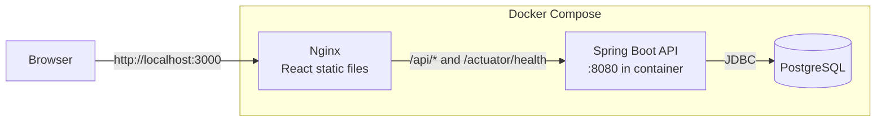
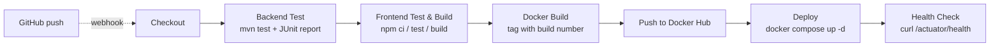
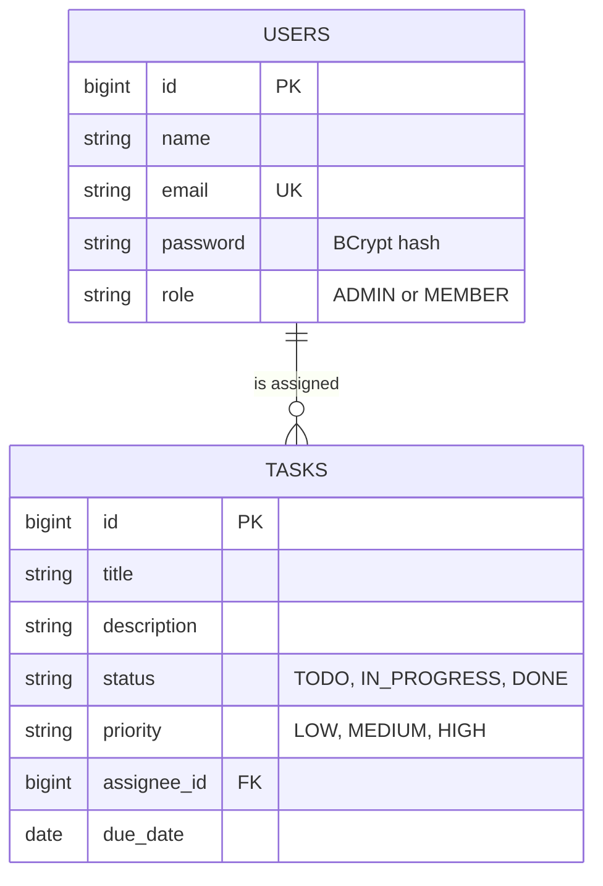

# TaskFlow

A small team task manager built as a DevOps mini project. Managers (admins) create and assign tasks, members move their own tasks through To Do, In Progress and Done, and everything builds, tests and deploys through a Jenkins pipeline into Docker containers.


## Features

- JWT login and registration with two roles: `ADMIN` (manager) and `MEMBER`
- Admins create, edit, assign and delete tasks; members update the status of their own tasks
- Dashboard with four stat cards, a tasks-per-member bar chart and a status donut chart
- Tasks table with status and priority filters, search, and a create/edit modal
- Kanban board (To Do / In Progress / Done) where changing the status moves the card
- `/api/system/info` reports version, Jenkins build number and git commit, shown in the UI footer, e.g. `v1.0 · build #12 · a1b2c3d`
- Demo data seeded on first start

## Architecture



## CI/CD pipeline



A failing stage stops the pipeline, so a broken test never reaches Docker Hub or the deployed app.

## Database



## Tech stack

| Layer    | Technology                                                                   |
| -------- | ---------------------------------------------------------------------------- |
| Frontend | React 18, Vite, Tailwind CSS, React Router, Axios, Recharts                  |
| Backend  | Java 17, Spring Boot 3 (Web, Data JPA, Security + JWT, Validation, Actuator) |
| Database | PostgreSQL 16                                                                |
| Tests    | JUnit 5 + MockMvc (backend), Vitest + Testing Library (frontend)             |
| DevOps   | Docker (multi-stage builds), Docker Compose, Nginx, Jenkins                  |

## Folder structure

```
task_flow/
├── backend/                 Spring Boot API
│   ├── src/main/java/com/taskflow/   model, repo, security, web, DataSeeder
│   ├── src/test/java/                MockMvc tests
│   └── Dockerfile                    Maven build stage -> JRE runtime stage
├── frontend/                React app
│   ├── src/pages/                    Login, Dashboard, Tasks, Board
│   ├── src/components/               Layout, modal, badges
│   ├── nginx.conf                    Serves the app, proxies /api to the backend
│   └── Dockerfile                    Node build stage -> Nginx
├── jenkins/Dockerfile       Jenkins with Docker CLI, Maven and Node.js
├── docs/screenshots/        Screenshots for this README
├── docker-compose.yml       postgres + backend + frontend
├── Jenkinsfile              CI/CD pipeline
├── .env.example             Settings template
└── CLAUDE.md
```

## Run with Docker

Requirements: Docker with Compose.

```bash
cp .env.example .env
docker compose up --build
```

| What         | URL                                   |
| ------------ | ------------------------------------- |
| App          | http://localhost:3000                 |
| API (direct) | http://localhost:8090/api/...         |
| Health       | http://localhost:8090/actuator/health |
| Build info   | http://localhost:3000/api/system/info |

The first start takes a bit longer while the backend creates the tables and seeds the demo data. Stop with `docker compose down` (add `-v` to also wipe the database). The host ports are set by `FRONTEND_PORT` and `BACKEND_PORT` in `.env`.

### Demo logins

| Role   | Name           | Email              | Password     |
| ------ | -------------- | ------------------ | ------------ |
| Admin  | Priya Sharma   | admin@taskflow.com | `Admin@123`  |
| Member | Arjun Mehta    | arjun@taskflow.com | `Member@123` |
| Member | Neha Iyer      | neha@taskflow.com  | `Member@123` |
| Member | Rahul Verma    | rahul@taskflow.com | `Member@123` |
| Member | Sneha Kulkarni | sneha@taskflow.com | `Member@123` |

New accounts created from the Register form are always `MEMBER`.

## Run without Docker (development)

```bash
# Backend: needs a PostgreSQL database named taskflow (user/password taskflow)
cd backend && mvn spring-boot:run

# Frontend: dev server on http://localhost:5173, proxies /api to localhost:8080
cd frontend && npm install && npm run dev
```

## Run the tests

```bash
cd backend && mvn test        # 12 MockMvc tests on an in-memory H2 database
cd frontend && npm test       # Vitest
```

## API overview

| Method | Path                     | Access                 |
| ------ | ------------------------ | ---------------------- |
| POST   | `/api/auth/login`        | public                 |
| POST   | `/api/auth/register`     | public                 |
| GET    | `/api/auth/me`           | logged in              |
| GET    | `/api/tasks`             | logged in              |
| POST   | `/api/tasks`             | admin                  |
| PUT    | `/api/tasks/{id}`        | admin                  |
| PATCH  | `/api/tasks/{id}/status` | admin, or the assignee |
| DELETE | `/api/tasks/{id}`        | admin                  |
| GET    | `/api/users`             | logged in              |
| GET    | `/api/dashboard/stats`   | logged in              |
| GET    | `/api/system/info`       | public                 |
| GET    | `/actuator/health`       | public                 |

## Jenkins setup

1. **Build and start Jenkins** (UI on http://localhost:8081):

   ```bash
   docker build -t taskflow-jenkins ./jenkins
   docker run -d --name jenkins -p 8081:8080 -p 50000:50000 -v jenkins_home:/var/jenkins_home -v /var/run/docker.sock:/var/run/docker.sock --add-host host.docker.internal:host-gateway taskflow-jenkins
   docker logs jenkins        # copy the initial admin password
   ```

   The command is on one line so it works in PowerShell, cmd and bash.

   The Docker socket mount lets pipeline builds use the host's Docker, and `host.docker.internal` lets the health check reach the deployed app.

2. **Finish the setup wizard**: install the suggested plugins (this includes Git, Pipeline, JUnit and Credentials Binding).

3. **Add credentials**: Manage Jenkins -> Credentials -> Global -> Add Credentials.
   - Kind: *Username with password*
   - Username: your Docker Hub username; Password: a Docker Hub access token
   - ID: `dockerhub-credentials`

4. **Create the pipeline**: New Item -> Pipeline -> Pipeline script from SCM -> Git. Enter your repository URL, branch `*/main`, script path `Jenkinsfile`.

5. **GitHub webhook** (build on every push):
   - In the Jenkins job configuration, tick *GitHub hook trigger for GITScm polling*.
   - In the GitHub repo: Settings -> Webhooks -> Add webhook, payload URL `http://<your-public-jenkins-url>:8081/github-webhook/`, content type `application/json`, event: *Just the push event*.
   - Jenkins on a laptop is not reachable from GitHub; expose it with a tunnel such as ngrok, or just use *Build Now*.

## Testing the pipeline

**1. Green build.** Click *Build Now*. All seven stages turn green, the JUnit test trend appears on the job page, and the app is live at http://localhost:3000. Docker Hub shows `taskflow-backend` and `taskflow-frontend` tagged with the build number.

**2. Build number in the footer.** Look at the footer of the app, e.g. `v1.0 · build #1 · a1b2c3d`. Make any change, commit, push (or *Build Now* again) and refresh the page: the footer now shows `build #2` and the new commit hash. The same data is available at `/api/system/info`.

**3. A broken test stops the pipeline.** In `backend/src/test/java/com/taskflow/TaskFlowApiTests.java` change an expectation, for example `status().isCreated()` to `status().isOk()` in `adminCanCreateTask`, then commit and push. The *Backend Test* stage turns red, the failed test is listed in the JUnit report, and no later stage runs: nothing is pushed or deployed, so the previous version keeps running. Revert the change to get a green build again.

## Screenshots

Add images to [docs/screenshots](docs/screenshots) with these names: `login.png`, `dashboard.png`, `tasks.png`, `board.png`.

## Configuration

Settings live in `.env` (see [.env.example](.env.example)): database credentials, `JWT_SECRET`, ports, and the version/build values shown in the footer. Jenkins overrides `BUILD_NUMBER`, `GIT_COMMIT` and `IMAGE_TAG` automatically. Change `JWT_SECRET` before deploying anywhere public.
