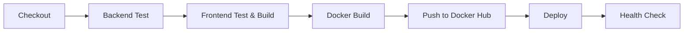
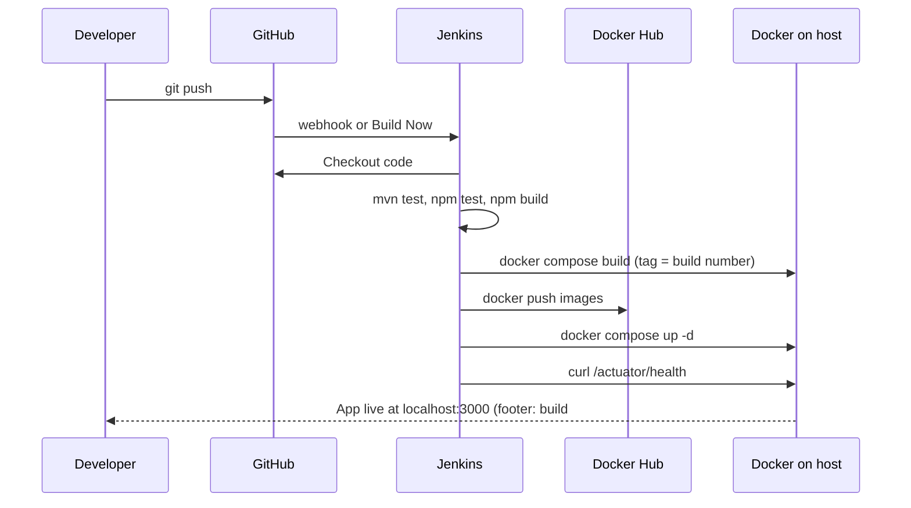

# TaskFlow: DevOps Project Guide

A study guide for explaining this project to a jury. It covers what DevOps is, why we use Docker and Jenkins, what every folder and file does, and how a code change travels from your laptop to the running app.

Read it top to bottom once. Then use sections 12 to 14 (jury questions, demo script, honest limitations) to practise.

---

## 1. The project in 30 seconds

**TaskFlow** is a small team task manager. A manager (ADMIN) creates tasks and assigns them to team members. Members update the status of their own tasks (To Do, In Progress, Done). A dashboard shows stats and charts.

The **DevOps part** is everything around the app: how the code is tested, packaged, delivered and run, automatically and the same way every time.

> One sentence for the jury: "We built a task management app, then automated its whole journey from `git push` to a running, health-checked deployment using Docker and a Jenkins pipeline."

---

## 2. What problem does DevOps solve?

Without DevOps, a typical student project looks like this:

| Problem | What happens |
| --- | --- |
| "It works on my machine" | The app runs on the developer's laptop but crashes on another computer (different Java version, missing database, etc.) |
| Manual deployment | Someone copies files to a server by hand, forgets a step, and the app breaks |
| Broken code reaches users | Nobody runs the tests before deploying |
| No traceability | Nobody knows which version is running or who changed what |
| Slow and scary releases | Deploying is a rare, stressful event |

**DevOps** (Development + Operations) is the practice of automating the path from code to running app so that it is **fast, repeatable and safe**.

| Our tool | Problem it solves |
| --- | --- |
| **Git / GitHub** | Stores every version of the code, so we know who changed what and can go back |
| **Docker** | "Works on my machine": the app and everything it needs are packaged together |
| **Docker Compose** | Starts several containers (database, backend, frontend) together with one command |
| **Jenkins** | Manual steps: runs tests, builds, pushes and deploys automatically |
| **Health check** | Silent failures: proves the deployed app is actually alive |
| **Build number in footer** | Traceability: you can see which build is running |

---

## 3. Key concepts (plain language)

| Term | Meaning | In our project |
| --- | --- | --- |
| **Source code** | The files developers write | `backend/src`, `frontend/src` |
| **Build** | Turning source code into something runnable | `mvn package` creates a `.jar`; `npm run build` creates static HTML/JS/CSS; `docker build` creates an image |
| **Test** | Code that checks other code works | 12 JUnit tests (backend), 5 Vitest tests (frontend) |
| **CI (Continuous Integration)** | Automatically build and test every change | Jenkins stages 1 to 3 |
| **CD (Continuous Delivery/Deployment)** | Automatically ship tested changes to where they run | Jenkins stages 4 to 7 |
| **Pipeline** | An ordered list of automated steps; if one fails, it stops | The `Jenkinsfile` |
| **Image** | A read-only package: the app plus everything it needs (like a recipe or snapshot) | `kiranteja77/taskflow-backend:3` |
| **Container** | A running instance of an image (like a running program) | `taskflow-backend-1` |
| **Registry** | An online store for images | Docker Hub |
| **Tag** | A label on an image version | `:3` (build number) and `:latest` |
| **Volume** | Storage that survives when a container is deleted | `pgdata` (the database files) |
| **Environment variable** | A setting passed in from outside the code | `DB_URL`, `JWT_SECRET`, `BUILD_NUMBER` |
| **Health check** | A request that asks "are you alive?" | `/actuator/health` returns `{"status":"UP"}` |
| **Credential** | A secret stored safely, not in code | `dockerhub-credentials` in Jenkins |

---

## 4. Docker, in depth

### 4.1 Why Docker?

A computer needs the right Java, the right Node, a Postgres database, the right ports and so on before it can run the app. Docker packages all of that into a **container**, so the app runs identically on your laptop, a teammate's laptop, Jenkins and a server.

Analogy: a shipping container. It does not matter what ship or truck carries it, because what is inside is sealed and the same.

### 4.2 Image vs container

- **Image** = the blueprint (built once, stored, shared).
- **Container** = a live instance created from the image (started, stopped, deleted).

One image can run as many containers as you like.

### 4.3 Multi-stage builds (why our Dockerfiles have two `FROM` lines)

**Backend** (`backend/Dockerfile`):

1. **Stage 1 (build):** `maven:3.9-eclipse-temurin-17`. It contains Maven and a full JDK, and compiles the code into `app.jar`.
2. **Stage 2 (runtime):** `eclipse-temurin:17-jre`. It contains only a Java runtime. We copy just the `.jar` over.

Result: the final image is small and has no compiler or build tools (smaller, faster, and safer). It also runs as a non-root user (`taskflow`).

**Frontend** (`frontend/Dockerfile`):

1. **Stage 1 (build):** `node:20-alpine` runs `npm ci` and `npm run build`, which produces static files in `dist/`.
2. **Stage 2 (runtime):** `nginx:1.27-alpine` serves those files. Node is not in the final image at all.

> Jury line: "Multi-stage builds keep build tools out of the production image, which makes it smaller and more secure."

### 4.4 What is in Docker for this project? (the 3 containers)

| Container | Image | Job |
| --- | --- | --- |
| **postgres** | `postgres:16-alpine` (official, ready-made) | The database. Stores users and tasks in the `pgdata` volume |
| **backend** | built from `backend/Dockerfile` | The Spring Boot REST API on port 8080 inside the container |
| **frontend** | built from `frontend/Dockerfile` | Nginx serving the React app, and forwarding `/api` to the backend |

Yes, PostgreSQL runs in Docker too. We did not write a Dockerfile for it; we use the official image.

### 4.5 How the containers talk to each other

```
Browser --> localhost:3000 --> [frontend / Nginx]
                                   |  /api/*  forwarded to  http://backend:8080
                                   v
                              [backend / Spring Boot] --JDBC--> [postgres:5432]
```

- Compose puts all three on one private network. Containers reach each other **by service name** (`backend`, `postgres`), not by IP.
- Only two ports are published to your computer: **3000** (the app) and **8090** (the backend directly, used for the health check). The database is not exposed to the outside.
- Why Nginx forwards `/api`: the browser only ever talks to one address (`localhost:3000`), so there are no cross-origin (CORS) problems.

---

## 5. Docker Compose, in depth

**What it is:** a file (`docker-compose.yml`) describing *all* the containers of the app, so you can start everything with one command: `docker compose up --build`.

**Why:** without it you would have to run three long `docker run` commands in the right order with the right flags.

### `docker-compose.yml`, section by section

| Section | What it does |
| --- | --- |
| `services.postgres` | Starts the database. Sets DB name, user and password from `.env`. Mounts the `pgdata` volume. Has a **healthcheck** (`pg_isready`) |
| `services.backend` | `build:` builds from `./backend`; passes `APP_VERSION`, `BUILD_NUMBER`, `GIT_COMMIT` as build args and env vars; sets `DB_URL`, `DB_USER`, `DB_PASSWORD`, `JWT_SECRET`; publishes port 8090; `depends_on: postgres: condition: service_healthy` means **wait until the database is really ready** |
| `services.frontend` | Builds from `./frontend`, publishes `3000:80`, starts after the backend |
| `image:` names | `${DOCKERHUB_USER}/taskflow-backend:${IMAGE_TAG}`: the same name Jenkins pushes to Docker Hub. Jenkins sets `IMAGE_TAG` to the build number |
| `volumes: pgdata` | Named storage so database data survives restarts |
| `${VAR:-default}` | Use the value from `.env` or the environment, otherwise the default after `:-` |

### `.env.example` and `.env`

- `.env.example` is a **template** committed to git (safe, no real secrets).
- `.env` is your local copy with real values. It is in `.gitignore` and **never committed**.

Why: configuration (ports, passwords, secrets) is kept **outside the code** so the same image can run anywhere with different settings. This is the "12-factor app" idea.

---

## 6. Jenkins, in depth

### 6.1 What is Jenkins and why use it?

Jenkins is an **automation server**. You give it a recipe (the `Jenkinsfile`) and it follows the recipe every time you ask, or every time code is pushed.

Without Jenkins, to release you would have to remember to: run backend tests, run frontend tests, build the frontend, build both images, tag them, log in to Docker Hub, push, restart containers and check the app is alive. Humans skip steps. **Jenkins never forgets, and it stops when something fails.**

Benefits to say to the jury:
1. **Repeatable:** same steps every time.
2. **Safe:** failing tests stop the release.
3. **Fast feedback:** you see within minutes whether a change broke something.
4. **Traceable:** each build has a number, logs and test reports.
5. **No secrets in code:** the Docker Hub token lives in Jenkins credentials.

### 6.2 Where does Jenkins run here?

In **its own Docker container** on your laptop, on port **8081** (`http://localhost:8081`).

- Image: built from `jenkins/Dockerfile`, which starts from the official Jenkins and adds the **Docker CLI + Compose, Maven and Node.js** (the tools the pipeline needs).
- It is started with `-v /var/run/docker.sock:/var/run/docker.sock`. That gives the Jenkins container access to **your computer's Docker engine**, so when the pipeline runs `docker build` or `docker compose up`, the new containers appear **next to** Jenkins on your machine (not nested inside it).
- `-v jenkins_home:/var/jenkins_home` keeps Jenkins' settings, jobs and credentials when the container restarts.
- `--add-host host.docker.internal:host-gateway` lets the Jenkins container reach the deployed app on your machine for the health check.

### 6.3 The `Jenkinsfile`, stage by stage

The `Jenkinsfile` lives in the repo ("pipeline as code"), so the pipeline itself is versioned and reviewed like any other code.



| # | Stage | What it does | Why it exists |
| --- | --- | --- | --- |
| 1 | **Checkout** | Pulls the code from GitHub; reads the short git commit hash | Jenkins works on a clean copy of exactly the code that was pushed |
| 2 | **Backend Test** | `mvn test` runs the 12 JUnit tests; the JUnit report is published | Catch backend bugs before shipping. **Failure stops everything** |
| 3 | **Frontend Test & Build** | `npm ci` (clean install), `npm test`, `npm run build` | Catch frontend bugs and prove it compiles |
| 4 | **Docker Build** | `docker compose build` builds both images, tagged with the **build number** and `latest` | Packages the tested code. The build number and commit are baked in so the app can report them |
| 5 | **Push to Docker Hub** | Logs in with `dockerhub-credentials` and pushes the images | Stores the images in a registry so any server can pull them. Keeps a history of every build |
| 6 | **Deploy** | `docker compose up -d` starts or updates the containers | Actually runs the new version |
| 7 | **Health Check** | `curl` `/actuator/health` up to 24 times (5 s apart) and looks for `"status":"UP"` | Proves the deployed app really started. If not, the build is marked failed |

Other parts of the Jenkinsfile:

| Piece | Meaning |
| --- | --- |
| `agent any` | Run on any available Jenkins machine (here, just one) |
| `environment { ... }` | Variables for the whole pipeline: image tag = `BUILD_NUMBER`, ports, health URL |
| `credentials('dockerhub-credentials')` | Loads the Docker Hub username and token **securely** (masked as `****` in logs) |
| `options { timeout(30 min) }` | Kills a stuck build |
| `post { always { junit ... } }` | Publishes test results even when tests fail |
| `post { success/failure }` | Final message |

### 6.4 What does "build #3" mean?

Jenkins counts every run: build #1, #2, #3... That number is:
- the Docker image **tag** (`taskflow-backend:3`),
- passed into the container as `BUILD_NUMBER`,
- returned by `GET /api/system/info`,
- shown in the **footer** of the app: `v1.0 · build #3 · a1b2c3d`.

So by looking at the footer you can tell exactly which Jenkins build and which git commit is running. That is **traceability**.

### 6.5 GitHub webhook (optional)

A webhook is GitHub calling Jenkins on every push, so builds start automatically. It needs Jenkins reachable from the internet (for example via ngrok). Without it, you press **Build Now**. The pipeline is identical either way.

---

## 7. End-to-end flow: what happens when you change code



If **any** step fails, the pipeline stops and the previous version stays running. That is the safety net.

---

## 8. Folder and file map

```
task_flow/
├── backend/                         Spring Boot API (Java 17)
│   ├── pom.xml                      Maven file: dependencies (Spring, JWT, Postgres, H2 for tests) and build settings
│   ├── Dockerfile                   Two-stage image: Maven build -> JRE runtime, non-root user, receives version/build/commit
│   ├── .dockerignore                Files Docker should NOT copy into the build (target/, .git)
│   └── src/
│       ├── main/java/com/taskflow/
│       │   ├── TaskFlowApplication.java   Entry point (starts Spring Boot)
│       │   ├── DataSeeder.java            On first start, creates 1 admin, 4 members, 20 tasks (only if DB is empty)
│       │   ├── model/                     Database entities
│       │   │   ├── User.java              users table (name, email, hashed password, role)
│       │   │   ├── Task.java              tasks table (title, description, status, priority, assignee, due date)
│       │   │   └── Role / TaskStatus / Priority   Enums (ADMIN/MEMBER, TODO/IN_PROGRESS/DONE, LOW/MEDIUM/HIGH)
│       │   ├── repo/                      Spring Data JPA repositories (database access without writing SQL)
│       │   ├── security/
│       │   │   ├── SecurityConfig.java    Which URLs are public; who may create/edit/delete (ADMIN only); stateless sessions
│       │   │   ├── JwtService.java        Creates and validates JWT tokens (12 hour expiry)
│       │   │   └── JwtAuthFilter.java     Reads the token on every request and sets the logged-in user
│       │   └── web/                       REST controllers
│       │       ├── AuthController         /api/auth/login, /register, /me
│       │       ├── TaskController         /api/tasks (CRUD + PATCH status with ownership rule)
│       │       ├── UserController         /api/users (for the assignee dropdown)
│       │       ├── DashboardController    /api/dashboard/stats (counts + chart data)
│       │       ├── SystemController       /api/system/info (version, build number, git commit)
│       │       ├── Dtos.java              Request/response shapes (so passwords never leave the server)
│       │       └── ApiExceptionHandler    Turns errors into clean JSON messages
│       ├── main/resources/application.yml Settings; values come from environment variables with defaults
│       └── test/                          12 MockMvc tests + test config using in-memory H2 database
│
├── frontend/                        React app (Vite + Tailwind)
│   ├── package.json                 Dependencies and scripts (dev, build, test)
│   ├── vite.config.js               Build config; dev proxy /api -> localhost:8080; Vitest config
│   ├── tailwind.config.js, postcss.config.js   Styling setup
│   ├── index.html                   Page shell; loads the Inter font
│   ├── nginx.conf                   Nginx rules: serve the app, forward /api and /actuator/health to backend, fall back to index.html for React routes
│   ├── Dockerfile                   Two-stage image: Node build -> Nginx
│   ├── .dockerignore
│   └── src/
│       ├── main.jsx, App.jsx        Entry point and routes
│       ├── api.js                   Axios client; adds the JWT to every request; handles expired login
│       ├── auth.jsx                 Login state, ProtectedRoute
│       ├── toast.jsx                Success/error pop-up messages
│       ├── hooks.js                 Shared task loading and status-change logic
│       ├── lib.js                   Helpers: filtering, date format, footer text
│       ├── components/              Layout (sidebar, top bar, footer), TaskModal, badges, spinner, empty states
│       ├── pages/                   Login, Dashboard, Tasks, Board
│       └── test/                    5 Vitest tests
│
├── jenkins/
│   └── Dockerfile                   Jenkins image + Docker CLI, Compose, Maven, Node 20
│
├── docs/
│   ├── PROJECT_GUIDE.md             This file
│   └── screenshots/                 Place for README screenshots
│
├── docker-compose.yml               Defines postgres + backend + frontend and how they connect
├── Jenkinsfile                      The 7-stage CI/CD pipeline
├── .env.example                     Config template (copy to .env)
├── .gitignore                       Files git must ignore (node_modules, target, .env)
├── .gitattributes                   Forces LF line endings (so shell scripts and Dockerfiles work on Linux)
├── CLAUDE.md                        Rule: update README and diagrams whenever features, ports or the pipeline change
└── README.md                        Project overview, diagrams, how to run, Jenkins setup
```

---

## 9. The application, briefly (the "Dev" half)

- **Roles:** ADMIN can create, edit, assign and delete tasks. MEMBER can only change the status of tasks assigned to them. Enforced in the backend (`SecurityConfig` + `TaskController`), not just by hiding buttons.
- **Login:** user logs in, backend returns a **JWT** (signed token). The frontend sends it as `Authorization: Bearer <token>` on every request. Passwords are stored as **BCrypt hashes**.
- **Dashboard:** `/api/dashboard/stats` returns totals, overdue count, tasks per member and status split; Recharts draws the bar and donut charts.
- **Seed data:** the first time the backend starts with an empty database, `DataSeeder` inserts demo users and 20 tasks.
- **Database:** `spring.jpa.hibernate.ddl-auto=update` creates and updates tables automatically from the entities.

Demo logins: `admin@taskflow.com` / `Admin@123` and `arjun@taskflow.com` / `Member@123`.

---

## 10. Ports cheat sheet

| Port | What | Where |
| --- | --- | --- |
| 3000 | The app (Nginx) | Your browser |
| 8090 | Backend API (direct) | Host, used for health check |
| 8080 | Backend inside its container | Container only |
| 5432 | PostgreSQL | Inside the Docker network only |
| 8081 | Jenkins UI | Your browser |
| 5173 | Vite dev server | Only when developing without Docker |

---

## 11. Problems we hit and solved (great for "what challenges did you face?")

| Problem | Cause | Fix |
| --- | --- | --- |
| Backend tests failed to start | The test `application.yml` replaced the main one, so the JWT secret was missing | Added the JWT settings to the test config |
| Port 8080 already in use | Another project on the machine used it | Moved the backend to 8090 |
| Jenkins had no SCM option | Git plugin not installed | Installed the Git plugin from Manage Plugins |
| `docker login` failed: "malformed HTTP Authorization header" | Token pasted with stray whitespace / wrong value | Re-created the credential, and the Jenkinsfile now pipes the token with `printf %s` |
| Image name had capital letters | Docker repository names must be lowercase | The Jenkinsfile lowercases the Docker Hub username |
| Deploy failed: port already allocated | An old stack was still running | Stopped the old stack (`docker compose -p task_flow down`) |
| PowerShell rejected the multi-line `docker run` | `\` line continuation only works in bash | Put the command on one line in the README |

---

## 12. Likely jury questions, with answers

**Q: What is DevOps?**
A culture and set of practices that join development and operations, using automation to build, test, deliver and run software quickly and reliably.

**Q: Why Docker instead of installing Java and Postgres on a server?**
Docker packages the app with its exact dependencies, so it runs the same everywhere. It removes "works on my machine", makes setup one command, and lets us throw away and recreate environments easily.

**Q: What is the difference between an image and a container?**
An image is the packaged blueprint. A container is a running instance of it.

**Q: Why Docker Compose?**
Our app has three parts (database, backend, frontend). Compose describes and starts them together with correct ordering, networking and configuration.

**Q: Why Jenkins?**
To automate testing, building, publishing and deploying. It runs the same steps on every change, stops when tests fail, and keeps logs and reports for each build.

**Q: What is a pipeline?**
An automated sequence of stages (checkout, test, build, package, publish, deploy, verify) defined as code in the `Jenkinsfile`. If a stage fails, the pipeline stops.

**Q: What is CI/CD?**
CI automatically builds and tests every change. CD automatically delivers tested changes to where the app runs. Our stages 1 to 3 are CI; stages 4 to 7 are CD.

**Q: What does the build number do?**
It identifies each Jenkins run. We use it as the image tag and show it in the app footer, so we can see which build is deployed.

**Q: Why push to Docker Hub if everything runs on one laptop?**
A registry is how images are shared between machines. In a real setup, a production server would pull the tested image from Docker Hub. It also keeps a versioned history of every build.

**Q: How do you keep secrets safe?**
Docker Hub credentials are stored in Jenkins credentials (masked in logs). App settings and the JWT secret come from environment variables / `.env`, which is git-ignored. Nothing secret is committed.

**Q: What happens if a test fails?**
The Backend Test (or Frontend) stage turns red, later stages are skipped, nothing is pushed or deployed, and the previous version keeps running.

**Q: What is a health check and why do you need one?**
A request to `/actuator/health`. "The container started" does not mean "the app works". The check proves the Spring app is up and connected to the database.

**Q: Why multi-stage Dockerfiles?**
They keep compilers and build tools out of the final image, making it smaller, faster to ship and more secure.

**Q: Why does Nginx forward `/api`?**
So the browser talks to a single origin (port 3000). This avoids CORS issues and hides the backend address.

**Q: Why a volume for Postgres?**
Containers are disposable. Without a volume, deleting the container would delete the data.

**Q: Why mount the Docker socket into Jenkins?**
So the pipeline can use the host's Docker engine to build images and start containers.

---

## 13. Demo script (5 minutes)

1. **Show the app** at `http://localhost:3000`. Log in as admin, show Dashboard, Tasks and Board. Point at the **footer** (`build #N`).
2. **Show containers:** `docker ps` (postgres, backend, frontend, jenkins).
3. **Show the repo:** `Dockerfile`s, `docker-compose.yml`, `Jenkinsfile`. Explain each in one sentence.
4. **Show Jenkins** (`localhost:8081`): the stage view, test results, console output.
5. **Green build:** click Build Now, watch the stages, then refresh the app and show the footer number increased.
6. **Break a test:** in `TaskFlowApiTests.java` change `status().isCreated()` to `status().isOk()` in `adminCanCreateTask`, commit, push, build. Show the red **Backend Test** stage and the skipped later stages. Revert, build again, green.

---

## 14. Honest limitations (say these before they ask)

- **Single host:** everything runs on one machine; real production would use several servers or Kubernetes.
- **No HTTPS:** a real deployment would put TLS in front of Nginx.
- **Jenkins has the Docker socket and runs as root:** convenient locally, but a real setup would restrict this.
- **No separate staging environment** and no automatic rollback (the health check fails the build, but does not roll back).
- **`ddl-auto=update`:** convenient for a demo; production would use migrations (Flyway or Liquibase).
- **Default JWT secret** in `.env.example` must be changed for anything public.
- **No monitoring or log aggregation** (Prometheus, Grafana, ELK would be next steps).

Possible future work: Kubernetes, Prometheus + Grafana monitoring, automated rollback, Flyway migrations, HTTPS, SonarQube code quality scan, separate dev/staging/prod environments.

---

## 15. Glossary

| Term | Meaning |
| --- | --- |
| **Artifact** | A file produced by a build (the `.jar`, the Docker image) |
| **Bind / publish a port** | Make a container port reachable from the host (`3000:80` means host 3000 to container 80) |
| **CI/CD** | Continuous Integration / Continuous Delivery |
| **Docker Hub** | Public registry for Docker images |
| **Idempotent** | Safe to run repeatedly with the same result (`docker compose up -d`) |
| **JWT** | JSON Web Token, a signed token proving who you are |
| **JUnit** | Java testing framework |
| **MockMvc** | Spring tool to test REST endpoints without starting a real server |
| **Nginx** | Web server and reverse proxy |
| **Reverse proxy** | A server that forwards requests to another server (Nginx to backend) |
| **Vitest** | JavaScript test runner |
| **Webhook** | An HTTP call one service makes to another when something happens |

---

## 16. Prompt to give Claude (to learn this project deeply)

Copy everything inside the box below into a new Claude conversation. Attach or paste `README.md`, `Jenkinsfile`, `docker-compose.yml`, `backend/Dockerfile`, `frontend/Dockerfile`, `frontend/nginx.conf` and this guide so Claude can see the real files.

```text
I am a student presenting a DevOps mini project called TaskFlow to a jury. I understand
the application itself, but I do NOT understand DevOps well. I need you to teach me so
that I can answer any question confidently.

PROJECT SUMMARY
- App: team task manager. Roles: ADMIN and MEMBER. JWT login. Dashboard, task table,
  kanban board.
- Stack: React + Vite + Tailwind (frontend), Java 17 Spring Boot 3 (backend),
  PostgreSQL (database).
- DevOps: Docker (multi-stage Dockerfiles), Docker Compose (postgres + backend +
  frontend), Nginx reverse proxy for /api, Jenkins running in a Docker container on
  port 8081 with the host Docker socket mounted, Docker Hub as the registry.
- Pipeline stages: Checkout, Backend Test (mvn test + JUnit report), Frontend Test &
  Build (npm ci/test/build), Docker Build (tagged with build number), Push to Docker
  Hub, Deploy (docker compose up -d), Health Check (curl /actuator/health).
- The build number and git commit are passed as environment variables into the backend
  image and shown in the UI footer, for example "v1.0 · build #12 · a1b2c3d".
- I have attached the real files (README, Jenkinsfile, docker-compose.yml, both
  Dockerfiles, nginx.conf, and my project guide). Base every explanation on those files
  and quote the exact lines you are explaining.

WHAT I WANT YOU TO DO
1. Teach me from zero, in simple language with analogies, in this order: what DevOps is,
   Git, build vs test, CI vs CD, images vs containers, registries, Docker, multi-stage
   builds, volumes and networks, Docker Compose, Jenkins, Jenkinsfile and pipeline,
   credentials, health checks, environment variables.
2. For each of my files (Jenkinsfile, docker-compose.yml, backend/Dockerfile,
   frontend/Dockerfile, frontend/nginx.conf, jenkins/Dockerfile, .env.example), walk
   through it LINE BY LINE: what the line does, why it is there, and what would break
   if I removed it.
3. Explain the full journey of one code change from "git push" to "the footer shows the
   new build number", step by step, including what each tool does at each step.
4. Explain why each tool was chosen and what the alternatives are (for example GitHub
   Actions or GitLab CI instead of Jenkins, Podman instead of Docker, Kubernetes instead
   of Compose) and why my choice is reasonable for this project size.
5. Explain what happens in failure cases: a failing unit test, a wrong Docker Hub
   token, a busy port, a database that is not ready, a failing health check.
6. Quiz me: ask me 20 jury-style questions one at a time, starting easy and getting
   harder. Wait for my answer, then grade it, correct mistakes and show a model answer.
7. At the end give me: a one-page cheat sheet, a 2-minute spoken explanation of the
   whole project, a list of 10 tricky questions a jury might ask with strong answers,
   and the limitations of my project with how I would improve each one.

STYLE
- Assume I am a beginner. Define every term the first time you use it.
- Use short paragraphs, tables and diagrams (Mermaid or ASCII) where they help.
- Be honest about the limits of my setup; do not oversell it.
- Ask me before moving on to the next topic so I can say "I understand" or "explain
  again".

Start with step 1.
```
